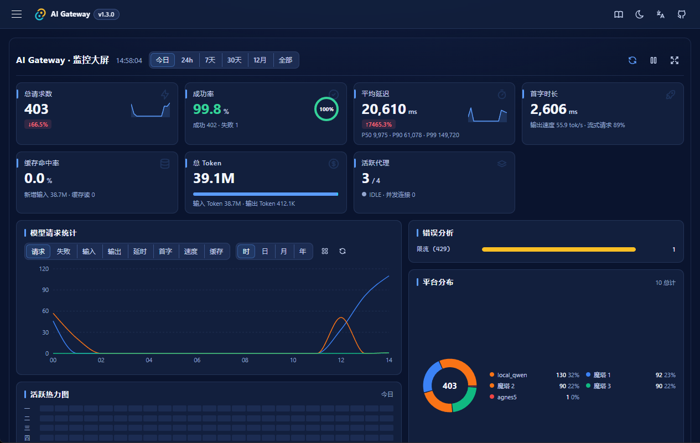
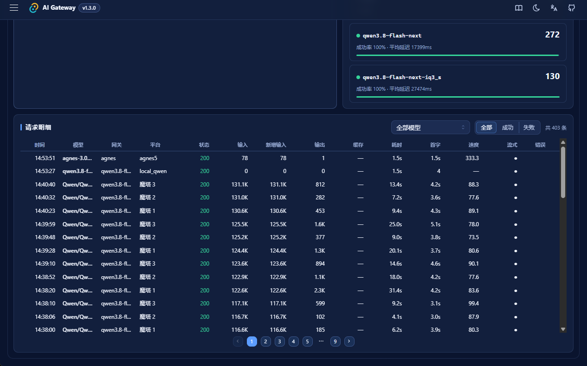
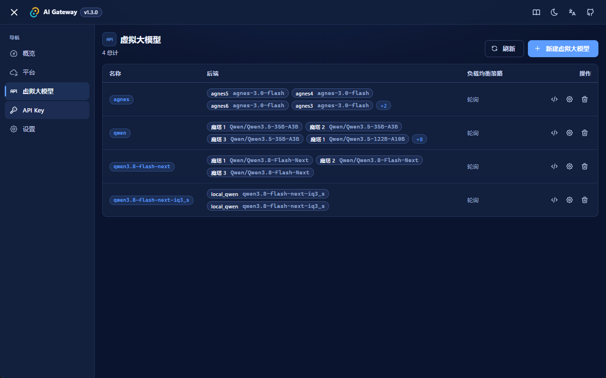
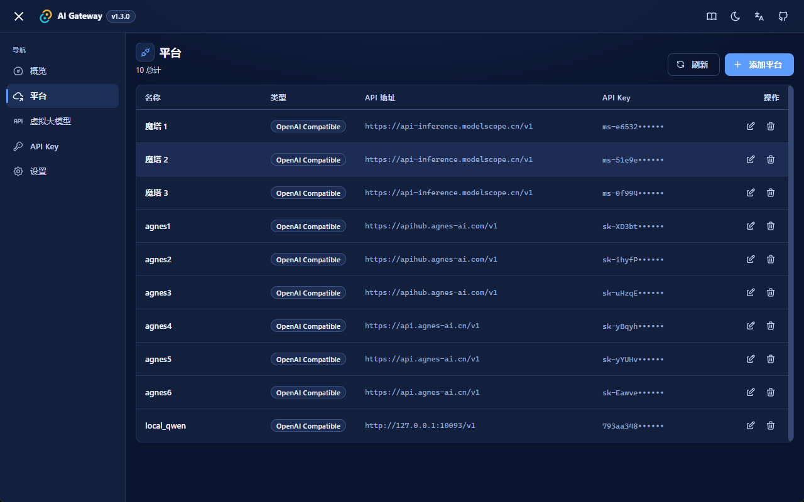
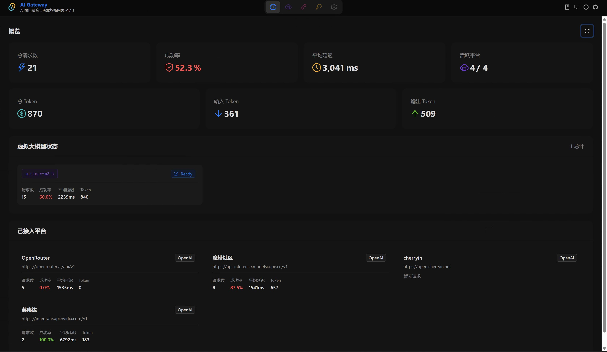
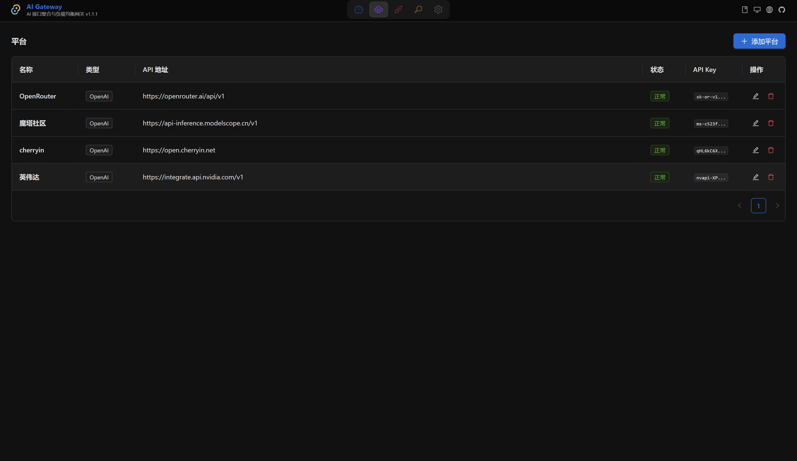
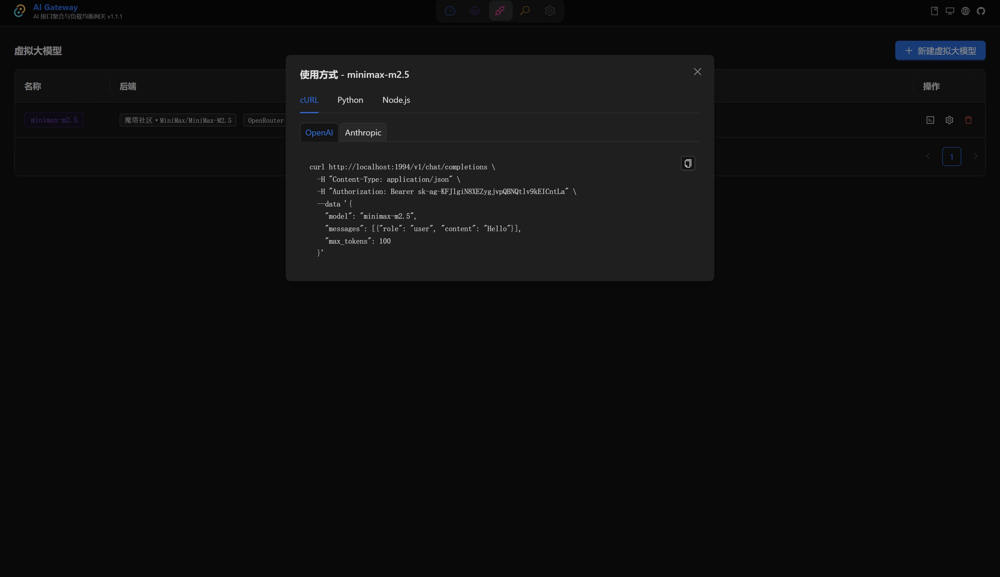
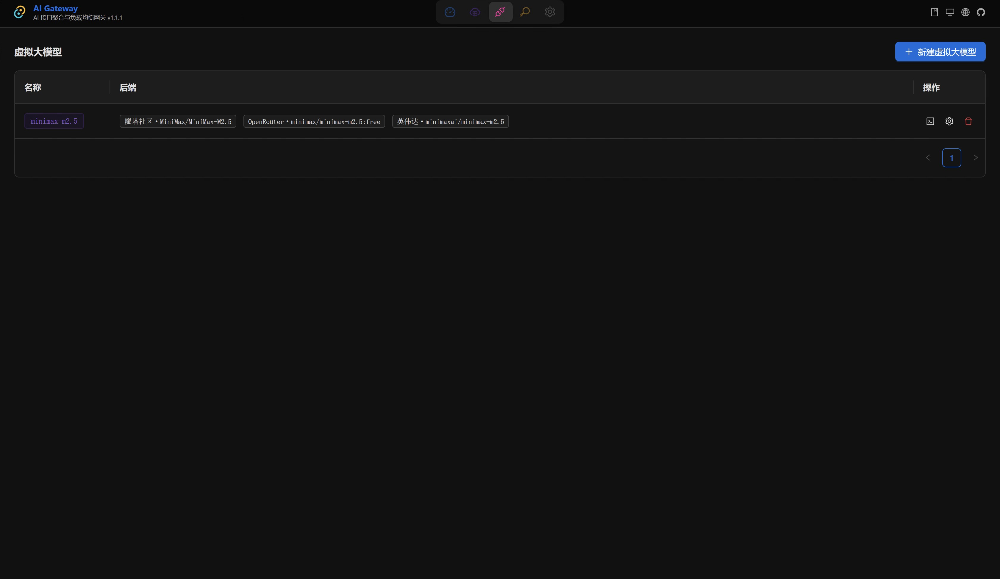

<p align="center">
  
</p>

<h1 align="center">🚀 AI Gateway</h1>

<p align="center">
  <strong>一个网关，聚合所有 AI 平台</strong><br/>
  多 Key 负载均衡 · 自动故障切换 · OpenAI & Anthropic 双协议 · 零代码改造
</p>

<p align="center">
  
  
  
  
  <a href="https://github.com/keiskeies/ai-gateway/stargazers"></a>
</p>

<p align="center">
  <a href="README.md">中文</a> | <a href="README_EN.md">English</a>
</p>

<p align="center">
  <a href="#-快速开始"><strong>30 秒上手 →</strong></a>
</p>

---

> 🌟 **如果这个项目对你有帮助，请给个 Star 支持一下！你的 Star 是我持续迭代的动力。**

---

## 😩 你是不是也遇到过这些问题？

- 🔴 API 调着调着就 **429 限流**了，请求直接报错
- 🔴 免费平台额度不够用，**3 RPM 根本不够塞牙缝**
- 🔴 DeepSeek 便宜但不稳定，OpenAI 稳定但太贵，**没法灵活切换**
- 🔴 多个 AI 平台 API 格式不同，**代码里一堆 if-else 切换**
- 🔴 想用 Claude 又想用 GPT，**SDK 和 Base URL 管不过来**

**AI Gateway 就是为了解决这些痛点而生的。**

---

## 📸 效果展示

<p align="center">
  
</p>
<p align="center"><em>监控大屏 — 每模型请求/延时/首字/输出速度/缓存命中率，时/日/月/年全时段趋势</em></p>

<details>
<summary>📱 点击查看更多截图</summary>

<p align="center">
  
</p>
<p align="center"><em>请求明细 — 逐条输入/新增输入/输出/缓存/耗时/首字/速度，支持模型与状态筛选</em></p>

<p align="center">
  
</p>
<p align="center"><em>虚拟大模型 — 多后端聚合与负载均衡策略</em></p>

<p align="center">
  
</p>
<p align="center"><em>平台管理 — 15+ 平台预设，一键添加</em></p>

<details>
<summary>🕰️ 旧版界面截图（v1.2.x）</summary>

<p align="center">
  
</p>
<p align="center">
  
</p>
<p align="center">
  
</p>
<p align="center">
  
</p>

</details>

</details>

---

## ⚡ 核心能力

### 🎯 多 Key 负载均衡 — 限流瓶颈？不存在的

多个 API Key 轮询/加权/分流，**N 个 Key = N 倍吞吐量**：

```
你的应用（高频请求）
    │
    └──→ AI Gateway 智能负载均衡 ──┬── Key 1: sk-free-xxx1（3 RPM）
                                    ├── Key 2: sk-free-xxx2（3 RPM）
                                    ├── Key 3: sk-free-xxx3（3 RPM）
                                    └── Key 4: sk-free-xxx4（3 RPM）
                                        ↓
                            总吞吐量：4 × 3 = 12 RPM 🚀
```

> 💡 **白嫖党福音**：SiliconFlow、Groq 等平台免费额度 × 多账号 = 免费大模型无限用

### 🔀 5 种负载均衡策略

| 策略 | 一句话 | 最适合 |
|------|--------|--------|
| **轮询** | 一个接一个，雨露均沾 | 多 Key 突破限流 |
| **加权随机** | 权重大的多干活 | 后端性能不一 |
| **最少连接** | 谁闲谁接活 | 流式输出场景 |
| **优先级** | 便宜的先上，贵的兜底 | 省钱！DeepSeek → GPT 兜底 |
| **延迟优先** | 谁快选谁 | 在线服务对延迟敏感 |

### 🌐 OpenAI & Anthropic 双协议 — 一个入口全搞定

```
OpenAI SDK ──→ /v1/chat/completions ──┐
                                       ├──→ AI Gateway ──→ DeepSeek / Qwen / GPT / Claude ...
Anthropic SDK ──→ /v1/messages ───────┘
```

**零代码改造**，把 `base_url` 换成 `http://localhost:1994/v1` 就完事了。

### 🧠 思考模式 — 客户端说了算

客户端传什么思考参数，网关就翻译成上游认识的格式；客户端不传，网关不主动开启。

| 客户端传入 | 上游是 Claude | 上游是 OpenAI 兼容推理模型 |
|---|---|---|
| `reasoning_effort: high`（OpenAI） | `thinking: {type: "enabled", budget_tokens: 16384}` | `reasoning_effort: high` |
| `thinking: {budget_tokens: 10000}`（Anthropic） | 原样保留，`max_tokens` 不足时压缩 budget | `reasoning_effort: medium` |

- 后端可配置**思考参数风格**：`Auto` / OpenAI effort / Anthropic thinking / OpenRouter / Qwen / GLM / vLLM Qwen / 禁用
- 支持 Anthropic `thinking` / `redacted_thinking` 块的完整回放与跨协议签名缓存，多轮工具调用不会因缺少签名被上游拒绝
- `/v1/models` 额外返回 `capabilities` / `supported_parameters` / `reasoning`，读取这些字段的客户端可自动展示思考档位
- 注意：Qoder / Trae / WorkBuddy 等客户端是否展示“思考程度”开关，仍取决于其内置的模型能力表，不读取上述扩展字段

### 🛡️ 高可用 · 不怕单点故障

- 后端挂了？**自动切换**到健康的后端
- 被限流了？429 / 5xx / 超时 **自动重试** + 指数退避
- 完全透明：你的应用感知不到后端切换

### 📊 监控大屏 · 全链路性能统计

每个模型、每个时段（时/日/月/年）的完整性能画像：

- **8 项指标趋势**：请求 / 失败 / 输入 / 输出 / 延时 / 首字时长（TTFT）/ 输出速度（tok/s）/ 缓存命中
- **模型性能矩阵**：一屏看清所有模型的成功率、耗时、速度、缓存命中率，跟随指标自动排序
- **请求明细**：逐条记录输入 / 新增输入 / 输出 / 缓存读 / 耗时 / 首字 / 速度，支持模型与状态筛选、分页回溯
- **缓存命中率**（CC Switch 口径）：`命中 / (命中 + 新增输入)`，直观反映前缀缓存的真实收益

---

## 🆚 和其他方案的区别

| | AI Gateway | Nginx 反代 | One API | LiteLLM |
|---|---|---|---|---|
| **开箱即用** | ✅ 桌面 App + 服务器 | ❌ 需要写配置 | ✅ | ✅ |
| **可视化管理** | ✅ Web UI | ❌ | ✅ | ❌ |
| **负载均衡** | ✅ 5 种策略 | ✅ 有限 | ⚠️ 简单 | ✅ |
| **OpenAI 协议** | ✅ | ✅ | ✅ | ✅ |
| **Anthropic 协议** | ✅ 原生支持 | ❌ 需额外配置 | ✅ 转换 | ✅ 转换 |
| **自动故障切换** | ✅ | ⚠️ 需配置 | ⚠️ | ⚠️ |
| **远程模型获取** | ✅ 自动拉取 | ❌ | ❌ | ❌ |
| **本地部署** | ✅ 单二进制零依赖 | ✅ | ✅ Docker | ✅ pip |
| **桌面应用** | ✅ macOS/Win/Linux | ❌ | ❌ | ❌ |
| **语言** | Rust（高性能低内存） | C | Go | Python |

---

## ✨ 更多特性

- 🏪 **15+ 平台预设**：OpenAI / Anthropic / DeepSeek / Qwen / Gemini / GLM / 月之暗面 / 豆包 / Ollama / NVIDIA NIM / Azure / 云硅 / Groq / 零一万物 / 百川 ··· 一键添加
- 🔍 **远程模型获取**：选择平台后自动拉取可用模型列表，下拉选择无需手动输入
- 🧠 **智能能力识别**：聊天/代码/视觉/函数调用等能力自动填充
- 🔗 **reasoning_content 支持**：兼容 NVIDIA NIM 等平台思维链输出；OpenAI / Anthropic 思考参数双向翻译
- 🌙 **浅色 / 深色 / 跟随系统** 三种主题
- 🌍 **中英双语** UI
- ⚙️ 端口可在界面内修改，默认 1994
- 🧭 **六页控制台**：运行总览 / 流量 / 虚拟模型 / 平台 / 密钥 / 监控大屏，筛选与分页都写进地址，刷新、前进/后退都不丢
- 🧾 **请求轨迹与正文重放**：一次请求的每次后端尝试逐条可查；正文留存默认关闭，开启后可原样重放某一笔请求
- 🔔 **通知中心**：Key 即将过期、平台连续失败、配额超阈值、备份过期都会落库，顶栏铃铛一点就到
- 💰 **成本估算与预算配额**：按定价表算出每次请求的成本（并给出覆盖率），配额支持滚动窗口与超额拦截
- 🗄️ **整库备份与恢复**：一键快照、下载、删除，原地还原前自动再留一份安全快照
- 📤 **配置导出 / 导入与 CSV**：配置脱敏导出、预览后合并导入；流量按筛选导出 CSV，平台定价 CSV 批量进出
- ⚡ **实时刷新**：新请求与告警通过 SSE 推送，连接断开自动退回 30 秒轮询

---

## 🔐 登录鉴权

管理后台（平台配置、虚拟大模型、API Key、设置、概览与统计）需要登录后才能访问：

- **首次启动**：打开管理页面会进入「初始化管理员账号」，设置用户名和密码后自动登录。为避免局域网内被他人抢先注册，首次初始化仅允许从本机（127.0.0.1）发起。
- **会话**：登录状态保存在 HttpOnly Cookie 中，默认 7 天有效；右上角用户菜单可退出登录。
- **修改密码**：设置 → 账号安全。修改后其他设备上的登录会话会立即失效。
- **忘记密码**：停止应用，删除数据库中 `users` 与 `sessions` 两张表的记录后重启，会重新进入初始化流程。

访问控制范围：

| 路径 | 鉴权方式 |
|---|---|
| `/v1/chat/completions`、`/v1/completions`、`/v1/messages` | 网关 API Key（`Authorization: Bearer ...` 或 `x-api-key`） |
| `/v1/models` | 公开 |
| `/health` | 公开 |
| `/api/auth/status`、`/api/auth/login`、`/api/auth/setup` | 公开 |
| 其余 `/api/*`（平台 / 模型 / 虚拟大模型 / API Key / 设置 / 统计） | 管理员登录会话 |

> 尚未创建任何 API Key 时网关会放行 AI 请求（兼容旧配置）；创建 API Key 后必须携带有效 Key。账号密码保存在 SQLite 中（Argon2 哈希），`config.toml` 的 `admin_token` 为历史保留字段。

---

## 🚀 快速开始

### 方式一：下载桌面应用（推荐）

前往 [Releases](https://github.com/keiskeies/ai-gateway/releases) 下载对应平台安装包，双击即用。

### 方式二：从源码构建

```bash
git clone https://github.com/keiskeies/ai-gateway.git
cd ai-gateway

# 独立服务器模式
cargo run
# 访问 http://localhost:1994

# 或 Tauri 桌面应用模式
cargo install tauri-cli
cargo tauri dev
```

### 三步上手

```
0️⃣ 初始化管理员账号 → 登录管理后台
1️⃣ 添加平台 → 选预设 + 填 API Key → 保存
2️⃣ 创建虚拟模型 → 选策略 + 添加后端 → 启动
3️⃣ 改 base_url → 指向 http://localhost:1994/v1 → 完事
```

---

## 📖 调用示例

改一行代码就能接入，**无需其他任何修改**：

```python
# OpenAI SDK — 只改 base_url
from openai import OpenAI
client = OpenAI(
    base_url="http://localhost:1994/v1",  # ← 就改这一行
    api_key="your-token"
)
response = client.chat.completions.create(
    model="your-virtual-model",  # ← 填你创建的虚拟模型名
    messages=[{"role": "user", "content": "hello"}]
)

# Anthropic SDK — 同样只改 base_url
import anthropic
client = anthropic.Anthropic(
    base_url="http://localhost:1994",  # ← 就改这一行
    api_key="your-token"
)
response = client.messages.create(
    model="your-virtual-model",
    max_tokens=1024,
    messages=[{"role": "user", "content": "hello"}]
)
```

<details>
<summary>🔧 curl 示例</summary>

```bash
# OpenAI 兼容格式
curl http://localhost:1994/v1/chat/completions \
  -H "Authorization: Bearer YOUR_TOKEN" \
  -H "Content-Type: application/json" \
  -d '{"model":"your-virtual-model","messages":[{"role":"user","content":"hello"}]}'

# Anthropic 兼容格式
curl http://localhost:1994/v1/messages \
  -H "x-api-key: YOUR_TOKEN" \
  -H "anthropic-version: 2023-06-01" \
  -H "Content-Type: application/json" \
  -d '{"model":"your-virtual-model","messages":[{"role":"user","content":"hello"}],"max_tokens":1024}'

# 模型列表
curl http://localhost:1994/v1/models \
  -H "Authorization: Bearer YOUR_TOKEN"
```

</details>

---

## 🎯 谁在用？典型场景

| 场景 | 怎么用 | 收益 |
|------|--------|------|
| **白嫖党** | 多个免费 Key 轮询 | 免费额度 × N 倍 |
| **省钱党** | DeepSeek 优先 + GPT 兜底 | 成本降 80%+ |
| **稳定性党** | 多后端 + 自动故障切换 | 可用性 99.9% |
| **多平台党** | OpenAI + Claude + Qwen 统一入口 | 一行代码切换 |
| **团队党** | 统一网关 + API Key 管理 | 安全 + 可控 |

---

## 🏗️ 架构

```
┌──────────────────────────────────────────────────┐
│                    AI Gateway                     │
│                                                  │
│  ┌──────────┐  ┌───────────┐  ┌──────────────┐  │
│  │  OpenAI  │  │ Anthropic │  │  Admin Web   │  │
│  │  兼容端点 │  │  兼容端点  │  │  管理界面    │  │
│  └─────┬────┘  └─────┬─────┘  └──────────────┘  │
│        │              │                           │
│  ┌─────▼──────────────▼─────┐                     │
│  │    路由 & 负载均衡引擎    │                     │
│  └──┬────┬────┬────┬────┬──┘                     │
│     │    │    │    │    │                         │
│  ┌──▼─┐┌─▼──┐┌▼───┐┌▼──┐┌▼────┐                │
│  │Deep││Qwen││GLM ││GPT││Claude│  ← N 个后端    │
│  │Seek││    ││    ││-4o││     │                   │
│  └────┘└────┘└────┘└───┘└─────┘                │
└──────────────────────────────────────────────────┘
```

---

## ⚙️ 配置

编辑 `config.toml`（首次运行自动生成）：

```toml
[server]
host = "0.0.0.0"
admin_port = 1994
log_level = "info"

[database]
path = "data/ai-gateway.db"

[security]
encrypt_key = "your-secret-key"
admin_token = ""

[defaults]
lb_strategy = "RoundRobin"
max_retries = 2
retry_backoff_ms = 500
request_timeout_secs = 120
```

> 💡 管理端口也可在桌面应用的「设置」页面中直接修改，无需手动编辑配置文件。

---

## 🛠️ 技术栈

| 层 | 技术 |
|---|---|
| 后端 | Rust · Actix-Web · SQLite (r2d2) · Reqwest |
| 前端 | React · TypeScript · Mantine · Vite |
| 桌面端 | Tauri 2.0 |
| 数据库 | SQLite (rusqlite + r2d2 连接池) |

---

## 🗺️ Roadmap

- [x] 📊 更丰富的统计面板（监控大屏：每模型全时段趋势 / 请求明细 / 缓存命中率）
- [ ] 🔑 API Key 细粒度权限控制（按模型/按额度限流）
- [ ] 🌐 多语言网关（翻译 / TTS / Embedding 统一端点）
- [ ] 🔔 后端健康检查 & 异常告警通知
- [ ] 🐳 Docker 一键部署
- [ ] ☁️ 云端配置同步

> 有想要的功能？欢迎 [提 Issue](https://github.com/keiskeies/ai-gateway/issues)！

---

## 🤝 参与贡献

欢迎各种形式的贡献！

1. Fork 本仓库
2. 创建特性分支 (`git checkout -b feature/amazing-feature`)
3. 提交更改 (`git commit -m 'Add some amazing feature'`)
4. 推送到分支 (`git push origin feature/amazing-feature`)
5. 发起 Pull Request

---

## 📂 项目结构

```
ai-gateway/
├── src/                  # Rust 后端
│   ├── api/              # REST API
│   ├── db/               # 数据库层 (r2d2 连接池)
│   ├── proxy/            # 代理处理器
│   ├── lb/               # 负载均衡引擎
│   ├── protocol/         # OpenAI/Anthropic 协议适配
│   └── models/           # 数据模型
├── frontend/             # React 前端
│   └── src/
│       ├── i18n.ts       # 国际化
│       ├── presets.ts    # 平台/模型预设
│       └── pages/        # 页面组件
├── src-tauri/            # Tauri 桌面应用
├── doc/                  # 截图 & 文档
├── config.toml           # 配置文件
└── data/                 # SQLite 数据库
```

---

## ⭐ Star History

<p align="center">
  <a href="https://star-history.com/#keiskeies/ai-gateway&Date">
    
  </a>
</p>

---

## 📜 License

[MIT License](LICENSE)

---

<p align="center">
  觉得有用？给个 <a href="https://github.com/keiskeies/ai-gateway">⭐ Star</a> 支持一下呗！
</p>
