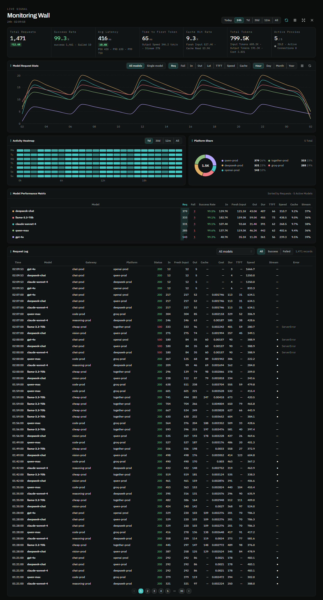
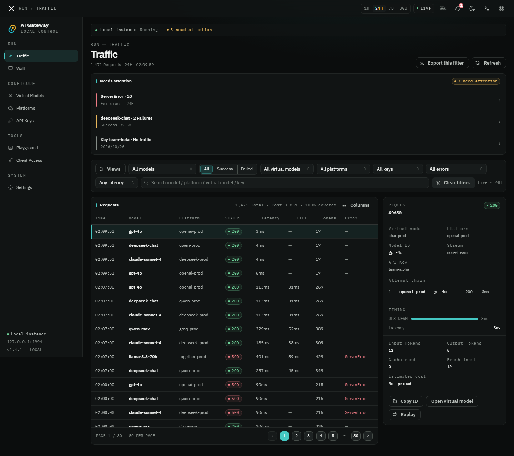
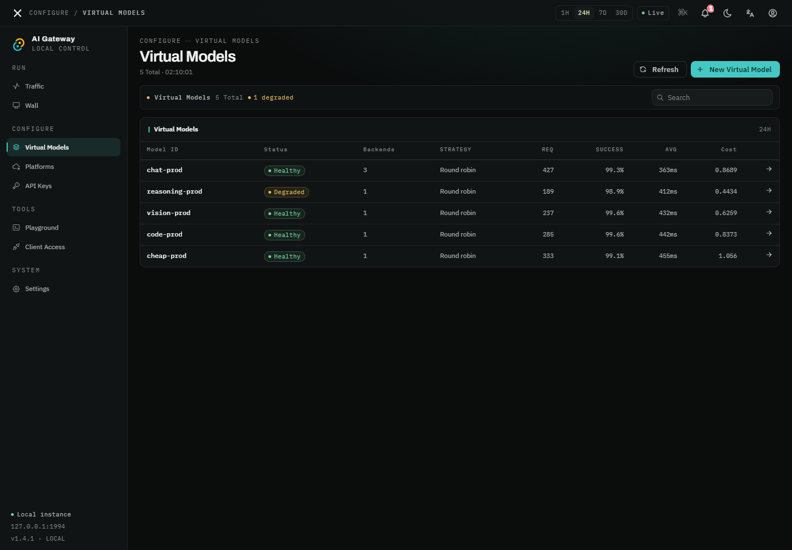
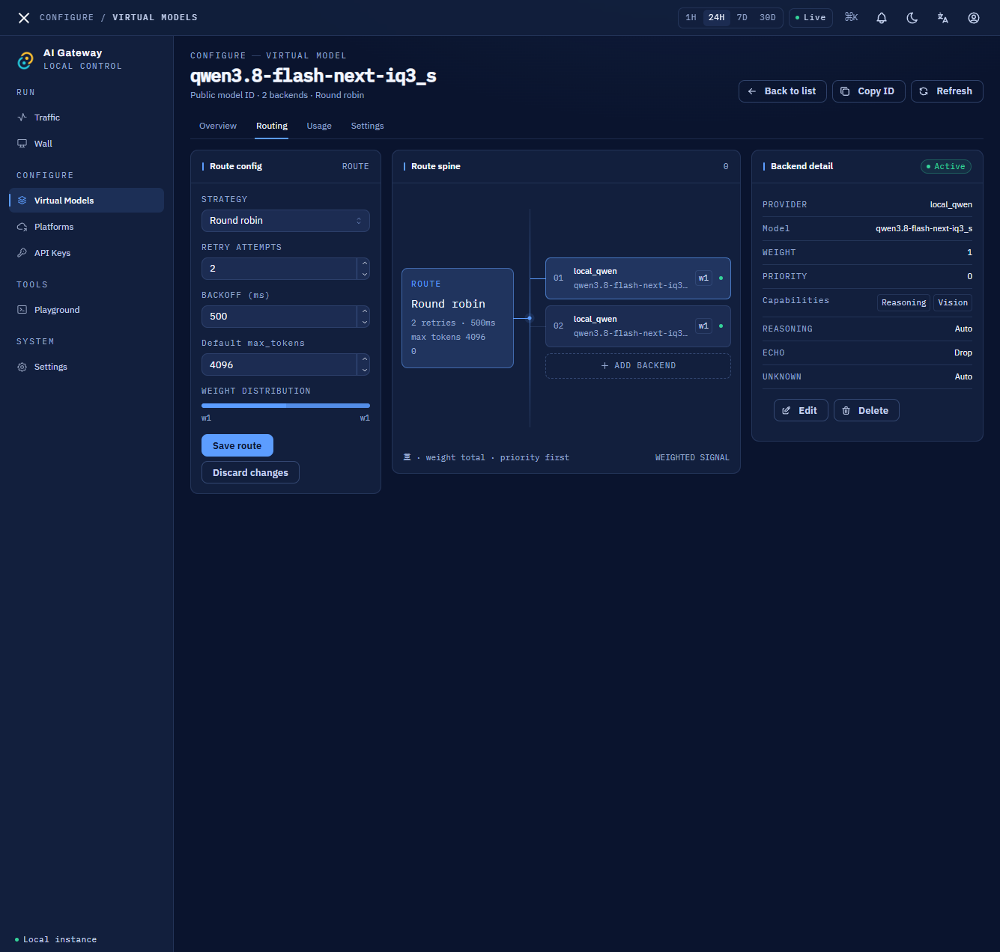
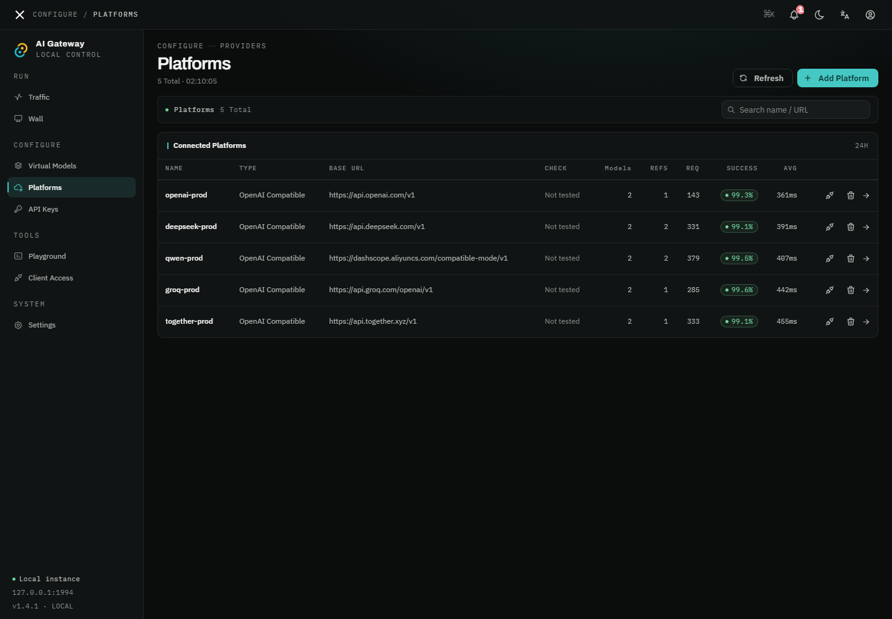
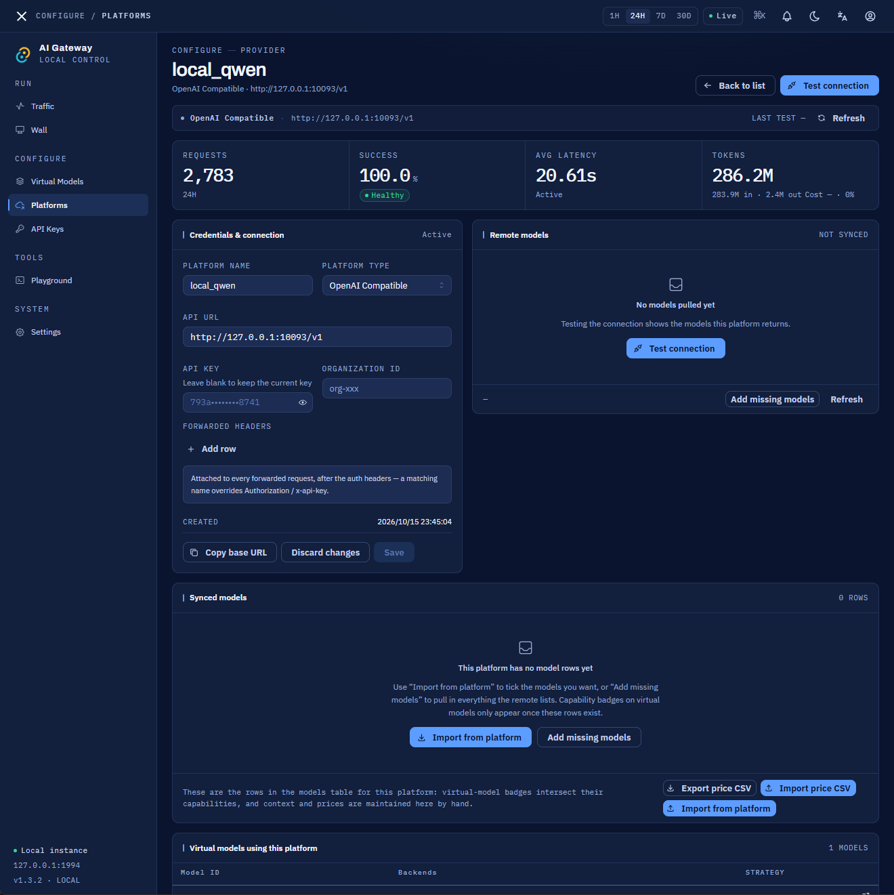
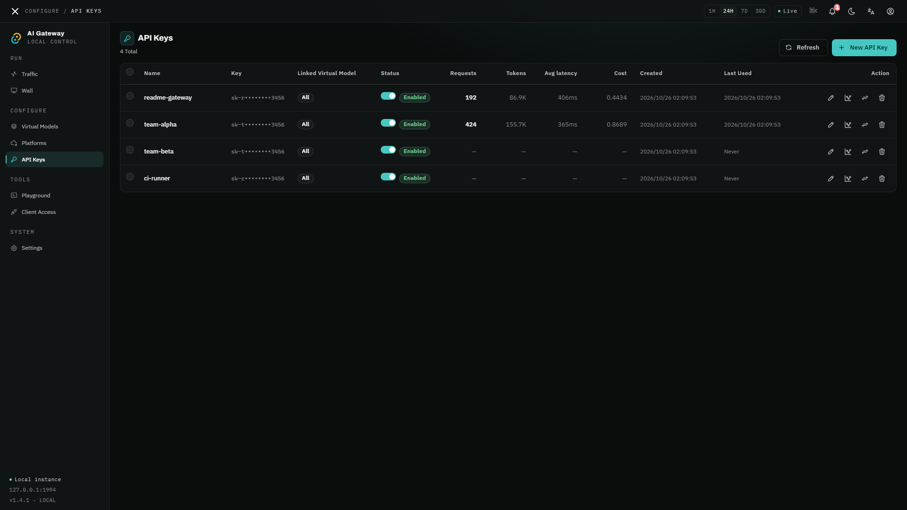
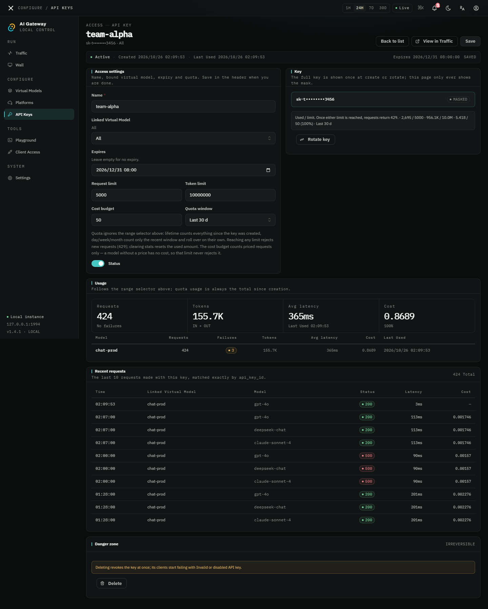
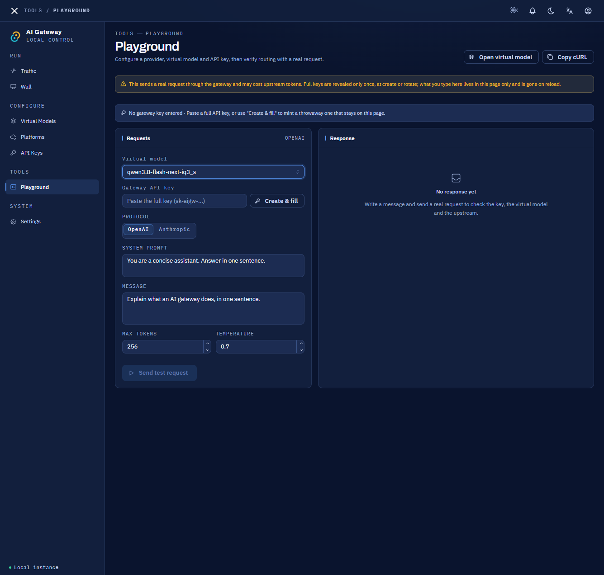
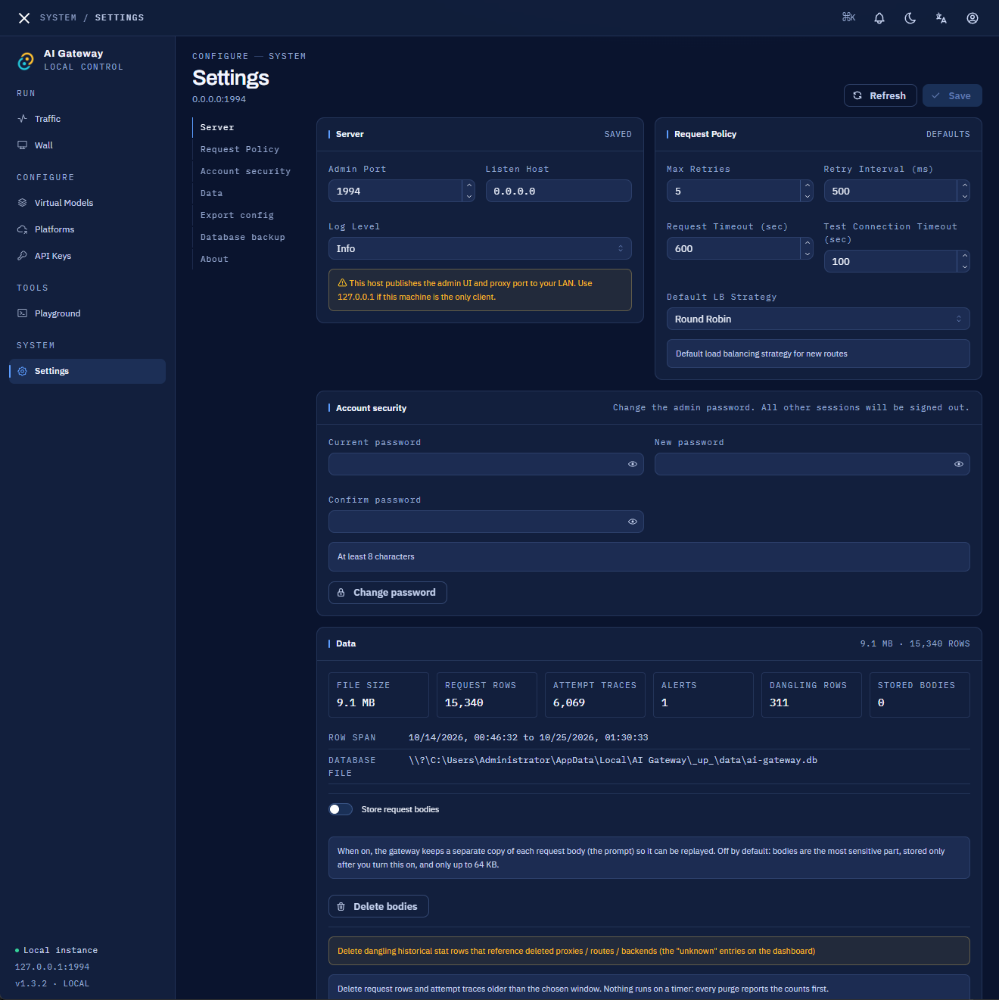

<p align="center">
  
</p>

<h1 align="center">🚀 AI Gateway</h1>

<p align="center">
  <strong>One Gateway to Aggregate All AI Platforms</strong><br/>
  Multi-Key Load Balancing · Auto Failover · OpenAI & Anthropic Dual Protocol · Zero Code Changes
</p>

<p align="center">
  
  
  
  
  <a href="https://github.com/keiskeies/ai-gateway/stargazers"></a>
</p>

<p align="center">
  <a href="README.md">中文</a> | <a href="README_EN.md">English</a>
</p>

<p align="center">
  <a href="#-quick-start"><strong>Get Started in 30 Seconds →</strong></a>
</p>

---

> 🌟 **If this project helps you, please give it a Star! Your support drives continuous improvement.**

---

## 😩 Sound Familiar?

- 🔴 **429 rate limits** hitting you mid-conversation
- 🔴 Free tier **3 RPM is nowhere near enough**
- 🔴 DeepSeek is cheap but flaky, OpenAI is stable but pricey — **no easy way to switch**
- 🔴 Multiple AI platforms with different API formats = **messy if-else in your code**
- 🔴 Want to use both Claude and GPT, but **managing multiple SDKs and base URLs is a pain**

**AI Gateway was built to solve all of these.**

---

## 📸 Screenshots

All screenshots below are from **v1.3.2** (dark theme).

<p align="center">
  
</p>
<p align="center"><em>Monitoring Wall — KPI strip plus per-model trends across eight metrics (requests / failures / input / output / latency / TTFT / speed / cache) at hour, day, month and year granularity, an activity heatmap with its own 7d/30d/12m/All window, platform share, performance matrix and request log. Fullscreen and refresh pause supported</em></p>

<details>
<summary>📱 Click to see the remaining pages</summary>

<p align="center">
  
</p>
<p align="center"><em>Traffic — a "needs attention" summary for rate limits, failures and idle keys; the request table filters by model, platform, key, status, error type and latency band with paging; the detail pane shows the attempt chain (status and duration of every backend try), TTFT / generation bars, cache read vs fresh input, estimated cost, and lets you copy the ID or replay the request</em></p>

<p align="center">
  
</p>
<p align="center"><em>Virtual Models — health status, backend count, strategy, request volume, success rate, average latency and cost right in the list</em></p>

<p align="center">
  
</p>
<p align="center"><em>Model detail · Routing — edit strategy, retry attempts, backoff, default max_tokens and weight distribution on the left; the route spine draws backends as a weighted, priority-ordered graph in the middle; inspect a single backend's provider, capability badges and reasoning-parameter handling on the right</em></p>

<p align="center">
  
</p>
<p align="center"><em>Platforms — connectivity check result, synced model count, how many virtual models reference it, request volume and success rate; degraded platforms are counted in the header</em></p>

<p align="center">
  
</p>
<p align="center"><em>Platform detail — credentials and forwarded headers (keys stay masked, revealed once on demand), remote model pull via Test connection, bulk model and price CSV import/export, and which virtual models depend on this platform</em></p>

<p align="center">
  
</p>
<p align="center"><em>API Keys — requests, tokens, average latency, cost and last-used time per key; a key can be bound to a single virtual model</em></p>

<p align="center">
  
</p>
<p align="center"><em>Key quota — expiry, request limit, token limit, cost budget and quota window (lifetime / day / week / month). Hitting any limit returns 429; the cost budget only applies to priced models</em></p>

<p align="center">
  
</p>
<p align="center"><em>Playground — pick a virtual model and protocol (OpenAI / Anthropic) and send a real request to verify routing and the upstream; mint a throwaway key in place, or copy the equivalent cURL</em></p>

<p align="center">
  
</p>
<p align="center"><em>Settings — port and bind address, request-policy defaults, account security, data statistics (rows / attempt traces / alerts / dangling rows / body retention), config export & import, whole-database backup and restore</em></p>

</details>

---

## ⚡ Core Capabilities

### 🎯 Multi-Key Load Balancing — Rate Limits? What Rate Limits?

Distribute requests across multiple API Keys — **N keys = N× throughput**:

```
Your App (high-frequency requests)
    │
    └──→ AI Gateway Smart Load Balancer ──┬── Key 1: sk-free-xxx1 (3 RPM)
                                           ├── Key 2: sk-free-xxx2 (3 RPM)
                                           ├── Key 3: sk-free-xxx3 (3 RPM)
                                           └── Key 4: sk-free-xxx4 (3 RPM)
                                               ↓
                                   Total throughput: 4 × 3 = 12 RPM 🚀
```

> 💡 **Free tier hack**: Multiple free accounts on SiliconFlow, Groq, etc. × load balancing = unlimited free AI

### 🔀 5 Load Balancing Strategies

| Strategy | TL;DR | Best For |
|----------|--------|----------|
| **Round Robin** | Take turns, fair and square | Multi-key rate limit bypass |
| **Weighted Random** | Higher weight = more work | Uneven backend performance |
| **Least Connections** | Give it to whoever's idle | Streaming output scenarios |
| **Priority** | Cheap first, expensive as fallback | Save money! DeepSeek → GPT fallback |
| **Latency Based** | Pick the fastest | Latency-sensitive online services |

### 🌐 OpenAI & Anthropic Dual Protocol — One Entry Point for Everything

```
OpenAI SDK ──→ /v1/chat/completions ──┐
                                       ├──→ AI Gateway ──→ DeepSeek / Qwen / GPT / Claude ...
Anthropic SDK ──→ /v1/messages ───────┘
```

**Zero code changes** — just swap `base_url` to `http://localhost:1994/v1` and you're done.

### 🛡️ High Availability — No Single Point of Failure

- Backend down? **Auto-failover** to healthy backends
- Rate limited? 429 / 5xx / timeout **auto-retry** with exponential backoff
- Fully transparent: your app never notices backend switches

### 📊 Monitoring Wall — Full-Chain Performance Stats

A complete performance profile for every model, across every time granularity (hour / day / month / year):

- **8 metric trends**: requests / failures / input / output / latency / TTFT / output speed (tok/s) / cache hit
- **Model performance matrix**: success rate, duration, speed and cache hit rate for all models at a glance, auto-sorted by the selected metric
- **Request log**: per-request input / fresh input / output / cache read / duration / TTFT / speed, with model & status filters and pagination
- **Cache hit rate** (CC Switch semantics): `hit / (hit + fresh input)` — the real benefit of prefix caching

---

## 🆚 Comparison with Alternatives

| | AI Gateway | Nginx Reverse Proxy | One API | LiteLLM |
|---|---|---|---|---|
| **Ready to use** | ✅ Desktop App + Server | ❌ Manual config | ✅ | ✅ |
| **Visual management** | ✅ Web UI | ❌ | ✅ | ❌ |
| **Load balancing** | ✅ 5 strategies | ✅ Limited | ⚠️ Basic | ✅ |
| **OpenAI protocol** | ✅ | ✅ | ✅ | ✅ |
| **Anthropic protocol** | ✅ Native support | ❌ Extra config | ✅ Conversion | ✅ Conversion |
| **Auto failover** | ✅ | ⚠️ Manual config | ⚠️ | ⚠️ |
| **Remote model fetching** | ✅ Auto-fetch | ❌ | ❌ | ❌ |
| **Local deployment** | ✅ Single binary, zero deps | ✅ | ✅ Docker | ✅ pip |
| **Desktop app** | ✅ macOS/Win/Linux | ❌ | ❌ | ❌ |
| **Language** | Rust (high perf, low memory) | C | Go | Python |

---

## ✨ More Features

- 🏪 **15 platform presets**: OpenAI · Anthropic · DeepSeek · Qwen · Google Gemini · Groq · SiliconFlow · ZhipuAI · Moonshot · Doubao · NVIDIA · Together AI · OpenRouter · Ollama · Azure OpenAI ··· one-click add, or point at any OpenAI / Anthropic compatible endpoint by hand
- 🔍 **Remote model fetching**: Test connection pulls the upstream model list; tick the ones you want into the local model table, with capability badges (reasoning / vision / tool-calling) maintained per model
- 🧠 **Smart capability detection**: Chat/code/vision/function-calling capabilities auto-filled from presets
- 🔗 **reasoning_content support**: Compatible with chain-of-thought output from NVIDIA NIM etc.; OpenAI / Anthropic thinking parameters translated both ways
- 📡 **Custom forwarded headers**: append arbitrary request headers per platform (vendor-specific switches), with name-level override of Authorization / x-api-key
- 🎛️ **Playground**: pick a virtual model and protocol and send a real request from the UI to verify routing and upstream behaviour, or copy the equivalent cURL
- 🌙 **Light / Dark / System** theme modes
- 🌍 **Chinese & English** bilingual UI
- ⚙️ Configurable port from the UI, default 1994
- 🧭 **Seven pages**: Traffic · Monitoring Wall · Virtual Models · Platforms · API Keys · Playground · Settings. Filters, paging and time range live in the URL, so refresh and back/forward never lose state
- 🧾 **Attempt traces & replay**: every backend try of a request is listed; body retention is off by default, and once enabled a stored request can be replayed verbatim
- 🔔 **Notification centre**: expiring keys, repeated platform failures, quota breaches and stale backups are persisted and reachable from the header bell
- 💰 **Cost estimation & budgets**: per-request cost from the price table (with coverage ratio), quotas supporting rolling windows with over-limit rejection
- 🔑 **Per-key quotas**: expiry, request limit, token limit, cost budget and window (lifetime / day / week / month) per key, optionally bound to one virtual model
- 🗄️ **Whole-database backup & restore**: snapshot, download, delete; restoring in place keeps an extra safety snapshot first
- 📤 **Config export / import & CSV**: redacted config export with preview-then-merge; traffic exported to CSV honouring the active filters; platform prices bulk import/export
- ⚡ **Live updates**: new requests and alerts arrive over SSE, falling back to 30 s polling when the connection drops

---

## 🔐 Authentication

The dashboard (traffic & statistics, virtual models, platforms, API keys, Playground, settings) requires signing in:

- **First launch**: the dashboard opens the "Create admin account" screen. For safety, initial setup is only accepted from localhost (127.0.0.1) so a LAN peer cannot claim the admin account first.
- **Sessions**: stored in an HttpOnly cookie, valid for 7 days. Sign out from the user menu in the top-right corner.
- **Change password**: Settings → Account security. All other sessions are revoked immediately.
- **Forgot password**: stop the app, delete the rows in the `users` and `sessions` tables, then restart to run setup again.

Access control:

| Path | Authentication |
|---|---|
| `/v1/chat/completions`, `/v1/completions`, `/v1/messages` | Gateway API key (`Authorization: Bearer ...` or `x-api-key`) |
| `/v1/models` | Public |
| `/health` | Public |
| `/api/auth/status`, `/api/auth/login`, `/api/auth/setup` | Public |
| All other `/api/*` (platforms / models / virtual models / API keys / settings / stats) | Admin session |

> AI requests are allowed while no API key exists (legacy behavior); once a key is created it must be supplied. Credentials live in SQLite (Argon2 hashes); `admin_token` in `config.toml` is a legacy reserved field.

---

## 🚀 Quick Start

### Option 1: Download Desktop App (Recommended)

Head to [Releases](https://github.com/keiskeies/ai-gateway/releases) and download the installer for your platform.

### Option 2: Build from Source

```bash
git clone https://github.com/keiskeies/ai-gateway.git
cd ai-gateway

# Standalone server mode
cargo run
# Visit http://localhost:1994

# Or Tauri desktop app mode
cargo install tauri-cli
cargo tauri dev
```

### Three Steps to Get Going

```
0️⃣ Create the admin account → Sign in
1️⃣ Add Platform → Pick preset + Enter API Key → Save
2️⃣ Create Virtual Model → Pick strategy + Add backends → Start
3️⃣ Change base_url → Point to http://localhost:1994/v1 → Done
```

---

## 📖 API Usage

Change one line of code to integrate — **nothing else needed**:

```python
# OpenAI SDK — just change base_url
from openai import OpenAI
client = OpenAI(
    base_url="http://localhost:1994/v1",  # ← Change only this line
    api_key="your-token"
)
response = client.chat.completions.create(
    model="your-virtual-model",  # ← Your virtual model name
    messages=[{"role": "user", "content": "hello"}]
)

# Anthropic SDK — same, just change base_url
import anthropic
client = anthropic.Anthropic(
    base_url="http://localhost:1994",  # ← Change only this line
    api_key="your-token"
)
response = client.messages.create(
    model="your-virtual-model",
    max_tokens=1024,
    messages=[{"role": "user", "content": "hello"}]
)
```

<details>
<summary>🔧 curl Examples</summary>

```bash
# OpenAI-compatible format
curl http://localhost:1994/v1/chat/completions \
  -H "Authorization: Bearer YOUR_TOKEN" \
  -H "Content-Type: application/json" \
  -d '{"model":"your-virtual-model","messages":[{"role":"user","content":"hello"}]}'

# Anthropic-compatible format
curl http://localhost:1994/v1/messages \
  -H "x-api-key: YOUR_TOKEN" \
  -H "anthropic-version: 2023-06-01" \
  -H "Content-Type: application/json" \
  -d '{"model":"your-virtual-model","messages":[{"role":"user","content":"hello"}],"max_tokens":1024}'

# List models
curl http://localhost:1994/v1/models \
  -H "Authorization: Bearer YOUR_TOKEN"
```

</details>

---

## 🎯 Who Uses This? Typical Scenarios

| Scenario | How | Benefit |
|----------|-----|---------|
| **Free-tier maximizer** | Round-robin across free keys | Free quota × N |
| **Cost saver** | DeepSeek first + GPT fallback | 80%+ cost reduction |
| **Reliability seeker** | Multi-backend + auto-failover | 99.9% availability |
| **Multi-platform user** | Unified OpenAI + Claude entry | One line to switch |
| **Team manager** | Shared gateway + API key management | Secure & controllable |

---

## 🏗️ Architecture

```
┌──────────────────────────────────────────────────┐
│                    AI Gateway                     │
│                                                  │
│  ┌──────────┐  ┌───────────┐  ┌──────────────┐  │
│  │  OpenAI  │  │ Anthropic │  │  Admin Web   │  │
│  │ Endpoint │  │ Endpoint  │  │  Dashboard   │  │
│  └─────┬────┘  └─────┬─────┘  └──────────────┘  │
│        │              │                           │
│  ┌─────▼──────────────▼─────┐                     │
│  │   Routing & Load Balance │                     │
│  │        Engine            │                     │
│  └──┬────┬────┬────┬────┬──┘                     │
│     │    │    │    │    │                         │
│  ┌──▼─┐┌─▼──┐┌▼───┐┌▼──┐┌▼────┐                │
│  │Deep││Qwen││GLM ││GPT││Claude│  ← N backends  │
│  │Seek││    ││    ││-4o││     │                   │
│  └────┘└────┘└────┘└───┘└─────┘                │
└──────────────────────────────────────────────────┘
```

---

## ⚙️ Configuration

Edit `config.toml` (auto-generated on first run):

```toml
[server]
host = "0.0.0.0"
admin_port = 1994
log_level = "info"

[database]
path = "data/ai-gateway.db"

[security]
encrypt_key = "your-secret-key"
admin_token = ""

[defaults]
lb_strategy = "RoundRobin"
max_retries = 2
retry_backoff_ms = 500
request_timeout_secs = 120
```

> 💡 The admin port can also be changed from the "Settings" page in the desktop app — no manual config editing needed.

---

## 🛠️ Tech Stack

| Layer | Technology |
|-------|-----------|
| Backend | Rust · Actix-Web · SQLite (r2d2) · Reqwest |
| Frontend | React · TypeScript · Mantine · Vite |
| Desktop | Tauri 2.0 |
| Database | SQLite (rusqlite + r2d2 connection pool) |

---

## 🗺️ Roadmap

- [x] 📊 Richer statistics dashboard (monitoring wall: per-model trends / request log / cache hit rate)
- [x] 🔑 Fine-grained API key permissions (bind to a virtual model · expiry · request / token / cost quotas · rolling-window rejection)
- [x] 🔔 Backend health checks & anomaly alerting (platform connectivity check + persisted notification centre)
- [ ] 🌐 Multi-modal gateway (translation / TTS / embedding unified endpoints)
- [ ] 🐳 Docker one-click deployment
- [ ] ☁️ Cloud config sync

> Have a feature request? [Open an Issue](https://github.com/keiskeies/ai-gateway/issues)!

---

## 🤝 Contributing

Contributions of all kinds are welcome!

1. Fork this repo
2. Create a feature branch (`git checkout -b feature/amazing-feature`)
3. Commit your changes (`git commit -m 'Add some amazing feature'`)
4. Push to the branch (`git push origin feature/amazing-feature`)
5. Open a Pull Request

---

## 📂 Project Structure

```
ai-gateway/
├── src/                  # Rust backend
│   ├── api/              # REST API
│   ├── db/               # Database layer (r2d2 connection pool)
│   ├── proxy/            # Proxy handlers
│   ├── lb/               # Load balancing engine
│   ├── protocol/         # OpenAI/Anthropic protocol adapters
│   └── models/           # Data models
├── frontend/             # React frontend
│   └── src/
│       ├── i18n.ts       # Internationalization
│       ├── presets.ts    # Platform/model presets
│       └── pages/        # Page components
├── src-tauri/            # Tauri desktop app
├── doc/                  # Screenshots & docs
├── config.toml           # Configuration file
└── data/                 # SQLite database
```

---

## ⭐ Star History

<p align="center">
  <a href="https://star-history.com/#keiskeies/ai-gateway&Date">
    
  </a>
</p>

---

## 📜 License

[MIT License](LICENSE)

---

<p align="center">
  Found this useful? Give it a <a href="https://github.com/keiskeies/ai-gateway">⭐ Star</a>!
</p>
