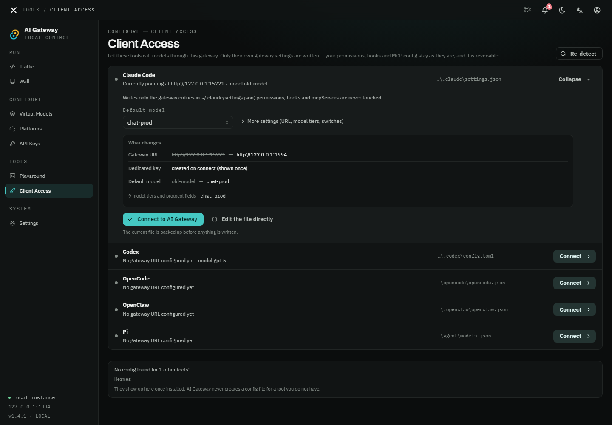

<p align="center">
  
</p>

<h1 align="center">🚀 AI Gateway</h1>

<p align="center">
  <strong>One gateway for every AI platform</strong><br/>
  Multi-key load balancing · Retries and backend rotation · OpenAI &amp; Anthropic protocols · No client changes
</p>

<p align="center">
  
  
  
  
  <a href="https://github.com/keiskeies/ai-gateway/stargazers"></a>
</p>

<p align="center">
  <a href="README.md">中文</a> ·
  <strong>English</strong> ·
  <a href="README_DE.md">Deutsch</a> ·
  <a href="README_FR.md">Français</a> ·
  <a href="README_ES.md">Español</a> ·
  <a href="README_PT.md">Português</a>
</p>

<p align="center">
  <a href="#-quick-start"><strong>Quick start →</strong></a>
</p>

---

> 🌟 If this project helps you, a Star helps others find it.

---

## 😩 What it solves

- You have several keys for the same provider and want to use them together without writing your own rotation and retry logic
- You want automatic retries on 429 / 5xx / upstream timeouts instead of implementing them in every client
- OpenAI and Anthropic mean two SDKs, two base URLs and two message formats
- Free tiers and paid models are mixed together, while cost, quotas and failure reasons are scattered
- You want to hand out keys to a team without sharing upstream provider credentials

AI Gateway puts all of that into one local process: **one entry point, one set of keys, one set of stats**.

---

## 📸 Screenshots

All screenshots are from the current desktop app (dark theme).

<p align="center">
  
</p>
<p align="center"><em>Monitoring Wall — KPI strip plus per-model trends across eight metrics (requests / failures / input / output / latency / TTFT / speed / cache) at hour, day, month and year granularity, an activity heatmap (7d / 30d / 12m / All), platform share, a performance matrix and the request log. Fullscreen and refresh pause are supported</em></p>

<details>
<summary>📱 Show the other pages</summary>

<p align="center">
  
</p>
<p align="center"><em>Traffic — a "needs attention" summary for rate limits, failures and idle keys; filter requests by model, platform, key, status, error type and latency band with paging; the detail pane shows the attempt chain (status and duration of each backend try), TTFT / generation bars, cache read vs fresh input and estimated cost, and lets you copy the ID or replay the request</em></p>

<p align="center">
  
</p>
<p align="center"><em>Virtual Models — health status, backend count, strategy, request volume, success rate, average latency and cost directly in the list</em></p>

<p align="center">
  
</p>
<p align="center"><em>Model detail · Routing — edit strategy, retries, backoff, default max_tokens and weights on the left; the route spine draws backends as a weighted, priority-ordered graph in the middle; inspect one backend's provider, capability badges and reasoning-parameter handling on the right</em></p>

<p align="center">
  
</p>
<p align="center"><em>Platforms — connectivity check result, synced model count, how many virtual models reference the platform, request volume and success rate; degraded platforms are counted in the header</em></p>

<p align="center">
  
</p>
<p align="center"><em>Platform detail — credentials and forwarded headers (saved keys are returned as a mask only, never in plaintext), remote model pull via Test connection, selective model import from the platform, price CSV import/export, and which virtual models depend on this platform</em></p>

<p align="center">
  
</p>
<p align="center"><em>API Keys — requests, tokens, average latency, cost and last-used time per key; a key can be bound to a single virtual model</em></p>

<p align="center">
  
</p>
<p align="center"><em>Key quota — expiry, request limit, token limit, cost budget and quota window (lifetime / day / week / month). Hitting any limit returns 429; the cost budget only applies to priced models</em></p>

<p align="center">
  
</p>
<p align="center"><em>Playground — pick a virtual model and protocol (OpenAI / Anthropic) and send a real request to verify routing and the upstream; mint a temporary key in place, or copy the equivalent cURL</em></p>

<p align="center">
  
</p>
<p align="center"><em>Client Access — card-based takeover for Claude Code / Codex / OpenCode / OpenClaw / Pi / Hermes local configs; expanding shows the diff, every apply is backed up, and disconnect rolls back</em></p>

<p align="center">
  
</p>
<p align="center"><em>Settings — port and bind address, request-policy defaults, account security, data statistics (rows / attempt traces / alerts / dangling rows / body retention), config export &amp; import, and whole-database backup and restore</em></p>

</details>

---

## ⚡ Core capabilities

### 🎯 Multiple keys: combine several keys from one provider

A platform stores one upstream credential; a virtual model has one or more backends. To combine several keys:

```
Create one platform per key → add them all to the same virtual model → choose round robin or least connections
```

```
Your app
   │
   └──→ Virtual model ──┬── Platform A (key 1, 3 RPM)
                         ├── Platform B (key 2, 3 RPM)
                         └── Platform C (key 3, 3 RPM)
```

Total throughput is the sum of the individual key limits; the gateway does not bypass upstream rate limits.

### 🔀 Load balancing strategies

| Strategy | Behaviour | Best for |
|----------|-----------|----------|
| **Round robin** | Distributes requests across the virtual model's backends in turn | Combining keys / accounts |
| **Weighted random** | Picks a backend by `weight` | Uneven backend capacity |
| **Least connections** | Picks the backend with the fewest requests waiting for upstream response headers | Smoothing short-request bursts |
| **Priority** | Always picks the active backend with the lowest `priority` value | A fixed primary backend |

> "Latency based" is selectable in the UI but currently runs the round-robin implementation; latency does not influence selection yet. "Priority" also does not fall back when the primary backend fails. See [Known limitations](#-known-limitations).

### 🌐 OpenAI &amp; Anthropic protocols

```
OpenAI SDK / OpenAI-compatible tools ──→ POST /v1/chat/completions ──┐
                                                                      ├──→ route → upstream
Anthropic SDK ─────────────────────────→ POST /v1/messages ──────────┘
```

| Path | Protocol | Notes |
|---|---|---|
| `/v1/chat/completions` | OpenAI | Main entry point |
| `/v1/completions` | OpenAI | Legacy path, parsed as chat |
| `/v1/messages` | Anthropic | Native Anthropic format |
| `/v1/models` | OpenAI | Public; returns virtual models and capability fields |

Same-protocol non-streaming responses pass through unchanged (only `model` is rewritten to the virtual model name); cross-protocol responses are rebuilt from the unified format, and streaming responses are converted chunk by chunk.

### 🧠 Reasoning: the client decides

Whatever reasoning parameters the client sends are translated into what the upstream understands. If the client sends none, the gateway does not turn reasoning on.

| Client sends | Upstream is Claude | Upstream is an OpenAI-compatible reasoning model |
|---|---|---|
| `reasoning_effort: "high"` (OpenAI) | `thinking: {type: "enabled", budget_tokens: 16384}` | `reasoning_effort: "high"` |
| `thinking: {budget_tokens: 10000}` (Anthropic) | Kept as-is; budget is clamped if `max_tokens` is too small | Mapped to the corresponding effort |

- Per-backend style: `Auto` / OpenAI effort / Anthropic thinking / OpenRouter / Qwen / GLM / vLLM Qwen / off
- `Auto` resolves by upstream type: `thinking` for Anthropic, `reasoning_effort` otherwise; `param_overrides` is merged last and wins
- Anthropic thinking signatures are replayed unchanged; cross-protocol tool loops use an in-memory signature cache (30 minutes, keyed by `tool_use.id`), and reasoning is disabled rather than fabricating a signature on a miss
- `/v1/models` exposes `capabilities` / `supported_parameters` / `reasoning` for reasoning models; whether a client shows a reasoning control still depends on its own model capability table

### 🛡️ Retries and backend rotation

- Per-route retries: `max_retries` and `backoff_ms` are adjustable in the UI; the retryable error types are fixed to 429 / 5xx / 408
- By default, retries **429 / 5xx / 408 (upstream timeout responses)** with exponential backoff (500 ms × 2ⁿ)
- Every retry goes back through the load balancer, so round robin usually lands on the next backend
- Streaming requests use a separate, longer `stream_timeout_secs` (default 1800 s) so long generations are not cut off by the normal request timeout

> Connection-level failures (unreachable backend, dial failure, network-level timeout) are not retried by default, and there is no health-check-driven ejection. If you need "fail over when a backend is down", put the backends in one virtual model behind round robin / least connections, or disable the failing backend manually. See [Known limitations](#-known-limitations).

### 📊 Monitoring wall

A complete performance profile for every model at hour / day / month / year granularity:

- **Eight metric trends**: requests / failures / input / output / latency / TTFT / output speed (tok/s) / cache hits
- **Performance matrix**: success rate, duration, speed and cache hit rate for all models, sorted by the selected metric
- **Request log**: input / fresh input / output / cache read / duration / TTFT / speed per request, with model and status filters and paging
- **Cache hit rate**: `hits / (hits + fresh input)`, reflecting the real benefit of prefix caching
- **Cost and coverage**: per-request cost from the price table plus the share of priced requests; unpriced models are labelled as such

---

### 🧾 Request details and retention

- **One row per request**: inbound path, per-attempt forward URL and upstream model, request headers, request/response bodies, tokens, TTFT, cache, cost and credits; retries and backend rotation are visible one by one
- **No sensitive values in the database**: headers are captured from an allowlist; `Authorization` / `x-api-key` / `Cookie` are always excluded; credentials in forward-URL query parameters (`key` / `token` / `sig`, ...) are redacted
- **Body capture is opt-in**: request and response bodies have separate switches with a 64 KB cap per record; streams store the raw upstream SSE, and cross-protocol requests store the raw upstream response rather than pretending to be the converted result
- **Retention**: off or 30/90/180/365 days; runs at startup and once a day. The minimum is 30 days — anything shorter would delete usage that monthly key quotas still count

### 🎟️ Upstream credit budgets

- **Platform budget + per-model credit price**: platforms can set a natural day/week/month budget (for example ModelScope 250 credits/day), and models can set a per-request price (1 or 2 credits)
- **Credit-aware routing**: platforms with insufficient balance are skipped; when all are exhausted the gateway returns 429 with the next reset time instead of silently using an over-quota account
- **Separate ledger**: charges, releases, adjustments and resets all have ledger rows; purging request history never “refunds” credits already spent
- **Visible and adjustable**: the request log shows credits for each request; platform list/detail shows remaining/total and unpriced model count; low/exhausted credits go to the notification center and can be adjusted manually

### 📚 Shared model catalog and time-of-day pricing

- **One URL, configured once**: the catalog is keyed by a hash of platform type + normalized base URL, so a second key for the same endpoint inherits the model list, prices and credit prices instead of re-syncing and re-typing; one edit applies to every account in that catalog
- **Accounts still own their rows**: the hash only decides the sharing scope — virtual models and backends stay attached to a concrete account, and a catalog is cleaned only when its last same-URL account is deleted (models move to a sibling account first)
- **Cache-tiered input pricing**: the input price splits into cache-miss / cache-hit / cache-write, so Anthropic `cache_read` and `cache_creation` are billed separately; the miss price stays as the fallback for older records
- **Peak and off-peak rates**: each model can define peak windows (`HH:MM-HH:MM`, wrapping past midnight) with their own four prices; the tier is picked from the request start time, so DeepSeek's night 0.02 / day 0.04 is directly configurable
- **History is never rewritten**: a price change affects later requests only; recorded costs, statistics and exports keep their original numbers

## 🧱 Known limitations

These are implementation boundaries that are easy to over-assume:

1. **"Latency based" is round robin**: the option exists, but selection still uses round robin and latency is not part of the ordering (`src/lb/mod.rs`).
2. **"Priority" does not downgrade on failure**: it always uses the active backend with the lowest `priority` value; a retry picks it again, and lower-priority backends stay idle.
3. **No health-check-driven ejection**: platform connectivity checks are for display and alerts only and do not affect routing; the route `fallback` field is not wired into the request path.
4. **Connection failures are not retried by default**: only 429 / 5xx / 408 are retried; network-level timeouts and dial failures count as `ConnectionError` and are not in the retry list.
5. **A key is still required when no keys exist**: with zero API keys configured the gateway does not validate the value, but the request must still carry an `Authorization` or `x-api-key` header (its value is not validated); once a key exists, a valid key is required.
6. **"Least connections" stops at the response headers**: the counter is released as soon as upstream response headers arrive, so it does not cover the lifetime of a streaming body and is not a full streaming-concurrency count.
7. **Request/response bodies are off by default**: two independent switches with a 64 KB cap per record; response details store the raw upstream response, streams keep only the first 64 KB, and cross-protocol requests are not the converted result the client saw.
8. **Auto purge is at least 30 days**: when off, purge is manual; deletion only frees SQLite pages and does not shrink the file (run `VACUUM` separately).
9. **Credits are a local ledger**: reserved/confirmed on success and released on failure, with manual adjustment; windows use the server's local natural day/week/month and may differ from the upstream bill.
10. **Client access is local-console only**: `/api/clients/*` is allowed only when the peer address is loopback, the `Host` is loopback, and the request carries no `Forwarded` / `X-Forwarded-*` / `X-Real-IP` header; otherwise it returns 403 and the page leaves the menu. That page edits `~/.claude` and `~/.codex` on the machine running the gateway, so a remote browser cannot use it. Behind nginx on the same machine, keep browsing by `127.0.0.1` and drop the source-IP headers (a custom domain counts as remote).
11. **Shared catalogs price by URL**: accounts on one base URL share a single set of models, prices and credit prices, so an individual key cannot carry its own pricing; use a different URL or platform type when prices really must differ.
12. **Peak tiers use the server's local timezone**: the tier comes from the request start time on the server, which may sit hours away from the upstream's billing timezone; windows may wrap midnight, but multi-timezone deployments need checking.

---

## 🆚 Comparison

| | AI Gateway | Nginx reverse proxy | One API | LiteLLM |
|---|---|---|---|---|
| **Form** | Desktop app + single-binary server | General-purpose reverse proxy | Server | Python service |
| **Visual management** | ✅ Built-in console | ❌ | ✅ Web console | ⚠️ Admin UI must be enabled |
| **Load balancing** | ✅ 4 effective strategies + latency option | ✅ Upstream round robin / hashing | ⚠️ Basic | ✅ |
| **OpenAI protocol** | ✅ | ✅ Pass-through | ✅ | ✅ |
| **Anthropic protocol** | ✅ Native | ❌ Pass-through only, no conversion | ✅ Conversion | ✅ Conversion |
| **Failure retries** | ✅ 429 / 5xx / 408 | ⚠️ Requires `proxy_next_upstream` | ✅ | ✅ Retries + fallbacks |
| **Remote model list** | ✅ Pulled on test connection | ❌ | ❌ | ⚠️ Config-driven |
| **Desktop app** | ✅ macOS / Windows / Linux | ❌ | ❌ | ❌ |
| **Implementation** | Rust | C | Go | Python |

> Based on each project's public documentation and default shape; check the respective project for details.

---

## ✨ More features

- 🏪 **15 platform presets**: OpenAI · Anthropic · DeepSeek · NVIDIA · Moonshot · ZhipuAI · Qwen · Doubao · SiliconFlow · Groq · Google Gemini · Together AI · OpenRouter · Ollama · Azure OpenAI. Presets fill in the base URL and model list; you still supply the key. Any OpenAI / Anthropic-compatible endpoint can also be added by hand
- 🔍 **Remote model sync**: Test connection pulls the upstream model list; syncing only adds models that are missing locally and does not overwrite existing prices, capabilities or display names
- 🧩 **Shared model catalog**: models and prices merge per platform type + base URL, so re-adding the same endpoint needs no re-configuration; different URLs or platform types stay independent
- 🏷️ **Capability badges**: reasoning / vision / embedding / rerank / tools, editable per model and in bulk; a virtual model's badges are the intersection of its backends' capabilities
- 🔗 **reasoning_content support**: chain-of-thought output from platforms such as NVIDIA NIM; OpenAI / Anthropic reasoning parameters translated both ways
- 📡 **Custom forwarded headers**: append arbitrary headers per platform, overriding `Authorization` / `x-api-key` by name
- 🎛️ **Playground**: pick a model and protocol, send a real request to verify routing and the upstream, mint a temporary key, or copy the equivalent cURL
- 🔌 **Client access**: one-click takeover and rollback for Claude Code / Codex / OpenCode / OpenClaw / Pi / Hermes local configs; only AI Gateway-owned fields are touched, every apply is backed up, with diff preview and a raw-config editor; the page and its API are available only from the local console (remote or reverse-proxied access returns 403)
- 🌙 **Light / dark / system themes**; UI available in Chinese and English
- 🧭 **Eight pages**: Traffic · Monitoring Wall · Virtual Models · Platforms · API Keys · Playground · Client Access · Settings. On the Traffic page, filters, paging and time ranges live in the URL, so refresh and back/forward keep state
- 🧾 **Attempt traces and replay**: every backend try of a request is recorded; request-body retention is off by default, and once enabled a stored request can be replayed verbatim
- 🔔 **Notification centre**: expiring keys, repeated platform failures, quota breaches and stale backups are persisted, reachable from the header bell
- 💰 **Cost estimation and budgets**: per-request cost from the price table (cache tiers and peak rates included) with a coverage ratio; key quotas support rolling windows and over-limit rejection
- 🔑 **Per-key quotas**: expiry, request limit, token limit, cost budget and window (lifetime / day / week / month) per key, optionally bound to one virtual model
- 🗄️ **Database backup and restore**: snapshot, download and delete; restoring in place keeps an extra safety snapshot first
- 📤 **Config and CSV**: config export excludes upstream secrets by default (opt in when needed) with preview before import; traffic exports to CSV using the active filters; platform prices import/export as CSV
- ⚡ **Live updates**: new requests and alerts arrive over SSE, falling back to 30-second polling when the connection drops
- 🖥️ **Closing the desktop window does not stop the gateway**: it destroys the WebView only; restoring from the tray returns to the page that was open

---

## 🔐 Authentication

The dashboard (traffic and stats, virtual models, platforms, API keys, Playground, client access, settings) requires signing in:

- **First launch**: the dashboard opens the "Create admin account" screen. Initial setup only accepts requests from the local machine (127.0.0.1), so a LAN peer cannot claim the account first
- **Sessions**: stored in an HttpOnly, SameSite=Strict cookie, valid for 7 days. Sign out from the user menu in the top-right corner
- **Change password**: Settings → Account security. Other devices are signed out immediately; the current device receives a new session
- **Forgot password**: stop the app, delete the rows in the `users` and `sessions` tables, then restart to run setup again

| Path | Authentication |
|---|---|
| `/v1/chat/completions`, `/v1/completions`, `/v1/messages` | Gateway API key (`Authorization: Bearer ...` or `x-api-key`) |
| `/v1/models` | Public |
| `/health` | Public |
| `/api/auth/status`, `/api/auth/login`, `/api/auth/setup` | Public (`setup` is effectively local-only) |
| All other `/api/*` (platforms / models / virtual models / API keys / client access / settings / stats / backups) | Admin session |

> With no API keys configured, the gateway does not validate the key value, but requests must still carry an `Authorization` or `x-api-key` header (the value is not validated); once a key exists, a valid key is required. Credentials live in SQLite (Argon2id hashes); `admin_token` in `config.toml` is a legacy reserved field.

---

## 🚀 Quick start

### Option 1: Download the desktop app (recommended)

Get the installer for your platform from [Releases](https://github.com/keiskeies/ai-gateway/releases). The desktop app ships for macOS (arm64 / x64), Windows x64 and Linux x64.

### Option 2: Build from source

```bash
git clone https://github.com/keiskeies/ai-gateway.git
cd ai-gateway

# Build the frontend first; output goes to ../static/
cd frontend && npm install && npm run build
cd ..

# Standalone server
cargo run
# Visit http://localhost:1994

# Or the Tauri desktop app
cargo install tauri-cli
cargo tauri dev
```

> Server mode serves `static/` directly, so build the frontend before running from source. The frontend build clears `static/`.

### Four steps

```
0️⃣ Create the admin account → Sign in
1️⃣ Add a platform → Pick a preset + enter the API key → Save
2️⃣ Create a virtual model → Pick a strategy + add backends → Enable
3️⃣ Change base_url → Point it at http://localhost:1994/v1 → Done
```

To combine several keys: repeat step 1 for each key from the same provider, then add all of those platforms to the same virtual model in step 2.

---

## 📖 Usage

```python
# OpenAI SDK — change base_url only
from openai import OpenAI
client = OpenAI(
    base_url="http://localhost:1994/v1",  # ← change this line
    api_key="your-gateway-key"            # ← API key created in the gateway
)
response = client.chat.completions.create(
    model="your-virtual-model",           # ← virtual model name
    messages=[{"role": "user", "content": "hello"}]
)

# Anthropic SDK — same idea
import anthropic
client = anthropic.Anthropic(
    base_url="http://localhost:1994",     # ← change this line (the SDK appends /v1/messages)
    api_key="your-gateway-key"
)
response = client.messages.create(
    model="your-virtual-model",
    max_tokens=1024,
    messages=[{"role": "user", "content": "hello"}]
)
```

<details>
<summary>🔧 curl examples</summary>

```bash
# OpenAI-compatible
curl http://localhost:1994/v1/chat/completions \
  -H "Authorization: Bearer YOUR_GATEWAY_KEY" \
  -H "Content-Type: application/json" \
  -d '{"model":"your-virtual-model","messages":[{"role":"user","content":"hello"}]}'

# Anthropic-compatible
curl http://localhost:1994/v1/messages \
  -H "x-api-key: YOUR_GATEWAY_KEY" \
  -H "anthropic-version: 2023-06-01" \
  -H "Content-Type: application/json" \
  -d '{"model":"your-virtual-model","messages":[{"role":"user","content":"hello"}],"max_tokens":1024}'

# Virtual model list (public)
curl http://localhost:1994/v1/models
```

</details>

---

## 🎯 Typical scenarios

| Scenario | How | Result |
|----------|-----|--------|
| **Combine free tiers** | Create one platform per account, add them to one virtual model, use round robin | Throughput adds up within each key's limit |
| **Control cost** | Point high-volume work at a virtual model backed by a cheaper model, switch to a premium one when needed | Expensive models only handle the requests that need them |
| **Stability** | Put several backends behind one virtual model and enable 429 / 5xx / 408 retries | Temporary rate limits and upstream blips are absorbed |
| **Mix platforms** | One virtual model each for OpenAI, Claude, Qwen | One SDK and base URL for all of them |
| **Share with a team** | One gateway plus per-key quotas and model binding | Upstream credentials stay private; usage is traceable |

---

## 🏗️ Architecture

```
┌──────────────────────────────────────────────────┐
│                    AI Gateway                     │
│                                                  │
│  ┌──────────┐  ┌───────────┐  ┌──────────────┐  │
│  │  OpenAI  │  │ Anthropic │  │  Admin Web   │  │
│  │ Endpoint │  │ Endpoint  │  │   Console    │  │
│  └─────┬────┘  └─────┬─────┘  └──────────────┘  │
│        │              │                           │
│  ┌─────▼──────────────▼─────┐                     │
│  │ Conversion · Routing ·   │                     │
│  │ Retries                  │                     │
│  └──┬────┬────┬────┬────┬──┘                     │
│     │    │    │    │    │                         │
│  ┌──▼─┐┌─▼──┐┌▼───┐┌▼──┐┌▼────┐                │
│  │Deep││Qwen││GLM ││GPT││Claude│  ← N backends  │
│  │Seek││    ││    ││-4o││     │                   │
│  └────┘└────┘└────┘└───┘└─────┘                │
└──────────────────────────────────────────────────┘
```

---

## ⚙️ Configuration

`config.toml` is created on first run; changes made in Settings are written back to it. An existing file is never overwritten.

```toml
[server]
host = "0.0.0.0"
admin_port = 1994
log_level = "info"

[database]
path = "data/ai-gateway.db"

[security]
encrypt_key = "ai-gateway-default-key-change-me"  # change this
admin_token = ""                                  # legacy reserved field

[defaults]
lb_strategy = "RoundRobin"
max_retries = 2
retry_backoff_ms = 500
request_timeout_secs = 120
stream_timeout_secs = 1800
test_connection_timeout_secs = 10
capture_request_bodies = false
```

> Port and bind-address changes require a restart; other settings apply immediately. `capture_request_bodies` controls whether request bodies are stored in the database and is off by default.

---

## 🛠️ Tech stack

| Layer | Technology |
|---|---|
| Backend | Rust 2021 · Actix-Web 4 · Reqwest |
| Database | SQLite (rusqlite with `bundled`, no system SQLite needed) · r2d2 pool |
| Frontend | React 19 · TypeScript 6 · Mantine 7 · Recharts · Vite 8 |
| Desktop | Tauri 2 |

---

## 🗺️ Roadmap

- [x] 📊 Monitoring wall: per-model trends / request log / cache hit rate
- [x] 🔑 Fine-grained API key quotas: model binding · expiry · request / token / cost limits · rolling windows
- [x] 🔔 Platform connectivity checks and a notification centre (display and alerts only; not used for routing yet)
- [x] 🧾 Request details, body capture and retention + 🎟️ upstream credit budgets and ledger
- [x] 🧩 Shared model catalog (accounts on one URL reuse it) + 💸 cache tiers and peak/off-peak pricing
- [ ] ⏱️ Wire real latency sampling into "latency based"
- [ ] 🩺 Health-check-driven ejection and priority downgrade
- [ ] 🧭 Wire the route `fallback` field into the request path
- [ ] 🌐 Multi-modal gateway (translation / TTS / embedding endpoints)
- [ ] 🐳 One-click Docker deployment
- [ ] ☁️ Cloud config sync

> Have a feature request? [Open an issue](https://github.com/keiskeies/ai-gateway/issues).

---

## 🤝 Contributing

1. Fork this repo
2. Create a feature branch (`git checkout -b feature/amazing-feature`)
3. Commit your changes (`git commit -m 'Add some amazing feature'`)
4. Push to the branch (`git push origin feature/amazing-feature`)
5. Open a pull request

---

## 📂 Project structure

```
ai-gateway/
├── src/                  # Rust backend (library + standalone binary)
│   ├── api/              # REST and admin APIs
│   ├── db/               # Database layer (r2d2 pool)
│   ├── proxy/            # Proxy handlers, stream conversion, signature cache
│   ├── lb/               # Load-balancing selector
│   ├── protocol/         # OpenAI / Anthropic adapters and reasoning parameters
│   ├── clients/          # Local client config takeover (Claude Code / Codex / ...)
│   └── models/           # Data models
├── frontend/             # React frontend (builds to ../static/)
├── src-tauri/            # Tauri desktop wrapper
├── e2e/                  # Playwright + pytest end-to-end tests
├── doc/                  # Screenshots
├── config.toml           # Runtime configuration
└── data/                 # SQLite database and backups
```

---

## ⭐ Star History

<p align="center">
  <a href="https://star-history.com/#keiskeies/ai-gateway&Date">
    
  </a>
</p>

---

## 📜 License

[MIT License](LICENSE)

---

<p align="center">
  Found this useful? Give it a <a href="https://github.com/keiskeies/ai-gateway">⭐ Star</a>.
</p>
